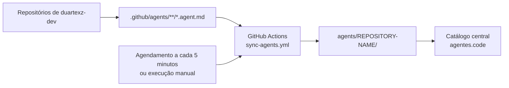

# agentes.code

[](https://github.com/duartexz-dev/agentes.code/actions/workflows/sync-agents.yml)

Catálogo centralizado de agentes do GitHub Copilot, com sincronização automatizada de arquivos `.agent.md` entre repositórios de `duartexz-dev`.

`agentes.code` é um repositório de automação e catálogo: não é uma aplicação web nem um modelo de inteligência artificial. O workflow reúne definições de agentes em um único local, mantendo os arquivos organizados por repositório de origem.

## Problema que o projeto resolve

Agentes personalizados podem ficar espalhados por vários repositórios. Este projeto procura esses arquivos em cada execução e mantém cópias centralizadas, sem exigir um workflow de sincronização em cada repositório de origem.

## Como funciona



O workflow [`sync-agents.yml`](./.github/workflows/sync-agents.yml) usa a GitHub REST API para listar os repositórios próprios acessíveis ao `SOURCE_READ_TOKEN`, consultar a branch padrão e localizar recursivamente arquivos `.agent.md` sob `.github/agents/`. O conteúdo é gravado no checkout do catálogo e enviado à branch padrão usando o `CATALOG_WRITE_TOKEN`.

O agendamento é configurado para ocorrer a cada cinco minutos. O GitHub Actions pode atrasar execuções agendadas; portanto, a sincronização não é instantânea. Também é possível iniciar uma execução pela aba **Actions** usando `workflow_dispatch`.

## Estrutura do repositório

```text
.
├── .github/
│   ├── agents/
│   │   └── JavaSage.agent.md
│   └── workflows/
│       └── sync-agents.yml
├── scripts/
│   └── generate-agent-catalog.mjs
├── agents/                       # criado/populado pelo workflow
│   └── REPOSITORY-NAME/
└── README.md
```

- `.github/agents/` contém os agentes locais deste repositório. Eles aparecem no catálogo com links diretos para seus arquivos, sem serem copiados para `agents/agentes.code/`.
- `.github/workflows/` contém a definição da automação.
- `scripts/generate-agent-catalog.mjs` reúne agentes locais de `.github/agents/` e agentes sincronizados em `agents/`, atualizando somente a seção delimitada do README.
- `agents/` contém cópias dos agentes encontrados nos repositórios de origem; os agentes locais são listados diretamente de `.github/agents/`.

## Descoberta e regras de sincronização

O workflow:

1. Lista os repositórios pertencentes à conta autenticada pelo token de leitura e usa `duartexz-dev` como proprietário das origens.
2. Ignora o próprio catálogo, repositórios arquivados e repositórios sem branch padrão.
3. Procura, recursivamente na branch padrão, arquivos com extensão `.agent.md` em `.github/agents/`.
4. Copia cada arquivo para `agents/NOME-DO-REPOSITORIO/CAMINHO-RELATIVO`, preservando a estrutura de subpastas da origem.
5. Compara o conteúdo antes de gravar. Arquivos novos são adicionados, arquivos modificados são atualizados e arquivos idênticos permanecem inalterados.
6. Cria e envia um commit somente quando há alterações no catálogo.

Arquivos removidos da origem **não** são excluídos automaticamente do catálogo. A automação registra falhas por repositório e continua processando as demais origens. Quando possível, publica as alterações válidas, mas encerra a execução como parcial/falha para que o problema não apareça como sucesso completo. Ações simultâneas são agrupadas para evitar gravações concorrentes.

## Configuração dos secrets

Antes da primeira execução, abra **Settings → Secrets and variables → Actions** neste repositório e crie os dois repository secrets abaixo. Cada token deve ser um Fine-grained Personal Access Token concedido à conta `duartexz-dev`.

| Secret | Uso | Acesso mínimo |
| --- | --- | --- |
| `SOURCE_READ_TOKEN` | Lista e lê os repositórios de origem pela GitHub REST API. | Metadata: **Read-only**; Contents: **Read-only** nos repositórios de origem que devem ser sincronizados. |
| `CATALOG_WRITE_TOKEN` | Faz checkout e envia os arquivos sincronizados para o catálogo. | Metadata: **Read-only**; Contents: **Read and write** somente em `duartexz-dev/agentes.code`. |

O token de leitura não grava no catálogo, e o token de escrita não é usado para ler as origens. Não inclua valores de tokens no repositório, no workflow ou em logs. As permissões declaradas para o `GITHUB_TOKEN` do workflow permanecem somente leitura; a gravação usa exclusivamente `CATALOG_WRITE_TOKEN`.

## Executar e acompanhar

### Execução automática

Depois que os secrets estiverem configurados e o workflow estiver disponível na branch padrão, o GitHub Actions tentará executá-lo a cada cinco minutos. O horário efetivo pode variar devido a atrasos do serviço.

### Execução manual

1. Abra a aba **Actions** do repositório.
2. Selecione **Synchronize Copilot agents**.
3. Clique em **Run workflow** e confirme a execução.

Consulte os logs da execução e o resumo final para verificar repositórios analisados e ignorados, agentes encontrados, novos, atualizados e inalterados, repositórios com erros e a situação geral.

## Diagnóstico

| Sintoma | O que verificar |
| --- | --- |
| Um repositório privado não aparece ou gera erro de acesso | Confirme que `SOURCE_READ_TOKEN` pertence à conta correta, tem acesso àquele repositório e possui Metadata e Contents em leitura. |
| Nenhum agente sincronizado é encontrado | Confirme que os arquivos estão na branch padrão dos repositórios de origem, dentro de `.github/agents/` ou subpastas, e que o nome termina exatamente em `.agent.md`. Agentes locais continuam listados a partir de `.github/agents/` neste repositório. |
| A execução termina como parcial | Consulte o resumo e os avisos por repositório. Falhas em uma origem não impedem a análise das demais; alterações válidas ainda podem ter sido enviadas. |
| A sincronização não consegue enviar alterações | Verifique se `CATALOG_WRITE_TOKEN` está limitado ao repositório central e possui Contents em leitura e gravação. Regras de proteção da branch também podem impedir o push direto. |
| Não aparece um commit novo | Se os arquivos sincronizados e a seção do README não tiverem alterações, nenhum commit é criado. `agents/` pode continuar ausente quando nenhuma origem remota tiver agentes. |

## Estado e limitações

- O workflow está configurado para execução agendada e manual; a agenda não garante atualização imediata.
- A busca ocorre na branch padrão de cada repositório elegível, não em todas as branches.
- A conta e o proprietário das origens estão configurados como `duartexz-dev` no workflow.
- O acesso a repositórios privados depende das permissões e dos repositórios selecionados no `SOURCE_READ_TOKEN`.
- Remoções na origem não propagam exclusões para o catálogo.
- O conteúdo sincronizado é gerado a partir das origens. Alterações feitas manualmente nas cópias podem ser substituídas em uma execução posterior.
- O diretório `agents/` pode ainda não existir até que uma sincronização encontre agentes remotos; agentes locais em `.github/agents/` são catalogados mesmo sem esse diretório.

## Manutenção

Adicione ou atualize os arquivos `.agent.md` nos repositórios de origem e envie as alterações para suas branches padrão. Aguarde a próxima execução agendada ou inicie uma execução manual. Para investigar falhas, use os logs e o resumo da execução em **Actions**; não é necessário adicionar workflows aos repositórios de origem.

## Available Agents

Esta tabela é gerada a partir dos agentes locais em `.github/agents/` e dos arquivos sincronizados em `agents/`. Cada entrada aponta para o arquivo correspondente e para o repositório de origem.

<!-- BEGIN AUTO-GENERATED AGENT CATALOG -->
| Agent | Description | Source repository | File |
| --- | --- | --- | --- |
| Java Project Curator | Use when identifying, documenting, or integrating a new Java exercise into the BuildJava.ln project catalog, including updating its catalog object and progress graphic. | [agentes.code](https://github.com/duartexz-dev/agentes.code) | [.github/agents/JavaSage.agent.md](./.github/agents/JavaSage.agent.md) |
| Design Orchestrator | Conduz a descoberta do produto, aprova a identidade visual e coordena especialistas, QA e auditoria de segurança. | [Avocrypto](https://github.com/duartexz-dev/Avocrypto) | [agents/Avocrypto/design-orchestrator.agent.md](./agents/Avocrypto/design-orchestrator.agent.md) |
| Design QA/Repair | Investiga e corrige bugs confirmados de funcionamento, responsividade, acessibilidade e integração sem redesenhar o produto. | [Avocrypto](https://github.com/duartexz-dev/Avocrypto) | [agents/Avocrypto/design-qa-repair.agent.md](./agents/Avocrypto/design-qa-repair.agent.md) |
| Design Security Auditor | Audita riscos de segurança e privacidade com análise independente somente leitura, evidências, severidade e limitações explícitas. | [Avocrypto](https://github.com/duartexz-dev/Avocrypto) | [agents/Avocrypto/design-security-auditor.agent.md](./agents/Avocrypto/design-security-auditor.agent.md) |
| Editorial Designer | Estrutura experiências orientadas a conteúdo com direção tipográfica, grid, ritmo de leitura e hierarquia editorial. | [Avocrypto](https://github.com/duartexz-dev/Avocrypto) | [agents/Avocrypto/editorial-designer.agent.md](./agents/Avocrypto/editorial-designer.agent.md) |
| Glassmorphism Designer | Cria interfaces em camadas com transparência e desfoque, preservando contraste, legibilidade e alternativas acessíveis. | [Avocrypto](https://github.com/duartexz-dev/Avocrypto) | [agents/Avocrypto/glassmorphism-designer.agent.md](./agents/Avocrypto/glassmorphism-designer.agent.md) |
| Maximalism Designer | Cria interfaces expressivas com composição, cor e tipografia de personalidade, sem sacrificar legibilidade ou usabilidade. | [Avocrypto](https://github.com/duartexz-dev/Avocrypto) | [agents/Avocrypto/maximalism-designer.agent.md](./agents/Avocrypto/maximalism-designer.agent.md) |
| Minimalism Designer | Implementa interfaces minimalistas com hierarquia clara, tipografia consistente, espaços intencionais e navegação simples. | [Avocrypto](https://github.com/duartexz-dev/Avocrypto) | [agents/Avocrypto/minimalism-designer.agent.md](./agents/Avocrypto/minimalism-designer.agent.md) |
| Motion Designer | Implementa microinterações, feedback, estados e transições de interface funcionais, responsivos e acessíveis. | [Avocrypto](https://github.com/duartexz-dev/Avocrypto) | [agents/Avocrypto/motion-designer.agent.md](./agents/Avocrypto/motion-designer.agent.md) |
| Motion Graphics Designer | Cria movimento gráfico e narrativas animadas com tipografia, ilustração e transições de cena, distintos das microinterações de interface. | [Avocrypto](https://github.com/duartexz-dev/Avocrypto) | [agents/Avocrypto/motion-graphics-designer.agent.md](./agents/Avocrypto/motion-graphics-designer.agent.md) |
| Neobrutalism Designer | Cria interfaces neo-brutalistas com geometria, bordas, contraste e personalidade sem comprometer acessibilidade ou usabilidade. | [Avocrypto](https://github.com/duartexz-dev/Avocrypto) | [agents/Avocrypto/neobrutalism-designer.agent.md](./agents/Avocrypto/neobrutalism-designer.agent.md) |
| Neumorphism Designer | Projeta superfícies e controles táteis com profundidade suave, limites reconhecíveis, contraste e acessibilidade. | [Avocrypto](https://github.com/duartexz-dev/Avocrypto) | [agents/Avocrypto/neumorphism-designer.agent.md](./agents/Avocrypto/neumorphism-designer.agent.md) |
| Java Project Curator | Use when identifying, documenting, or integrating a new Java exercise into the BuildJava.ln project catalog, including updating its catalog object and progress graphic. | [BuildJava.ln](https://github.com/duartexz-dev/BuildJava.ln) | [agents/BuildJava.ln/JavaSage.agent.md](./agents/BuildJava.ln/JavaSage.agent.md) |
<!-- END AUTO-GENERATED AGENT CATALOG -->
